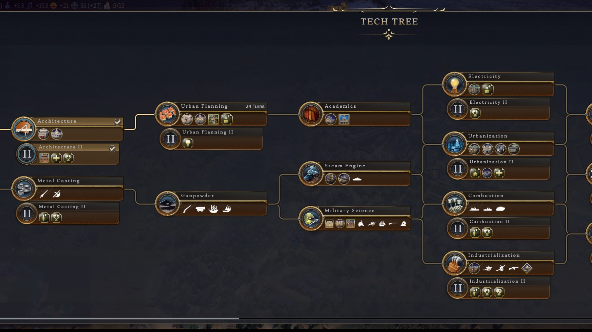
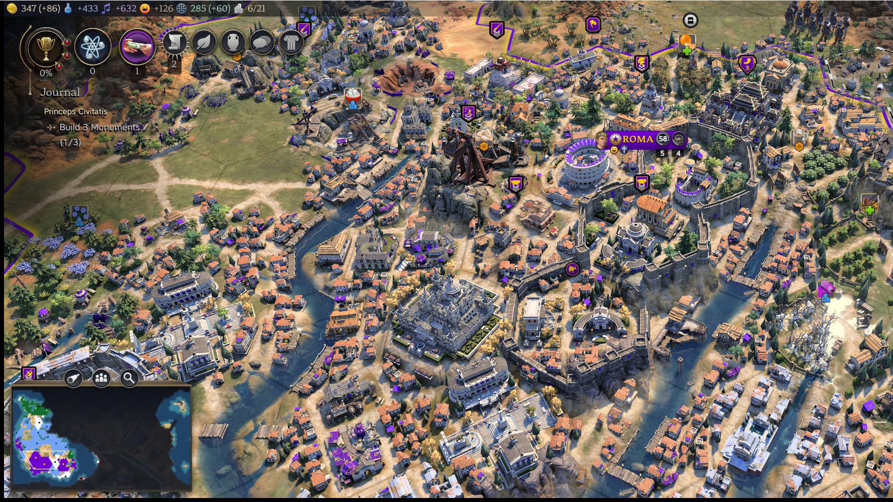
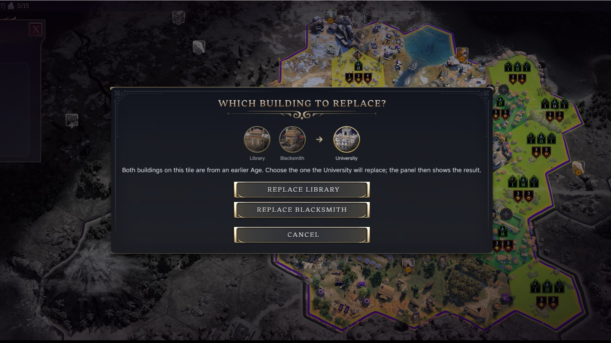
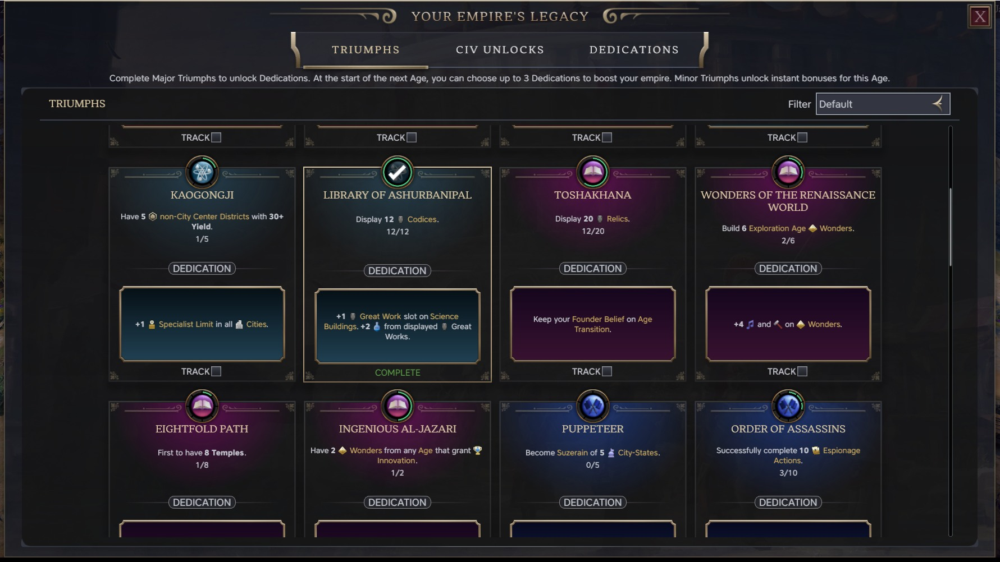
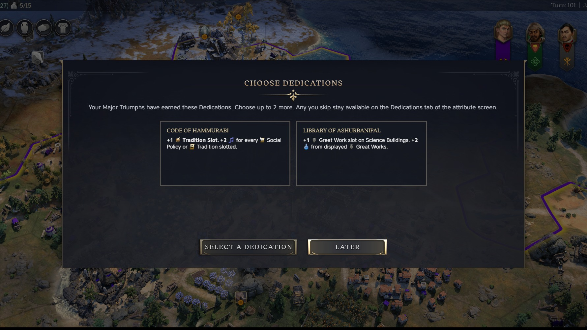
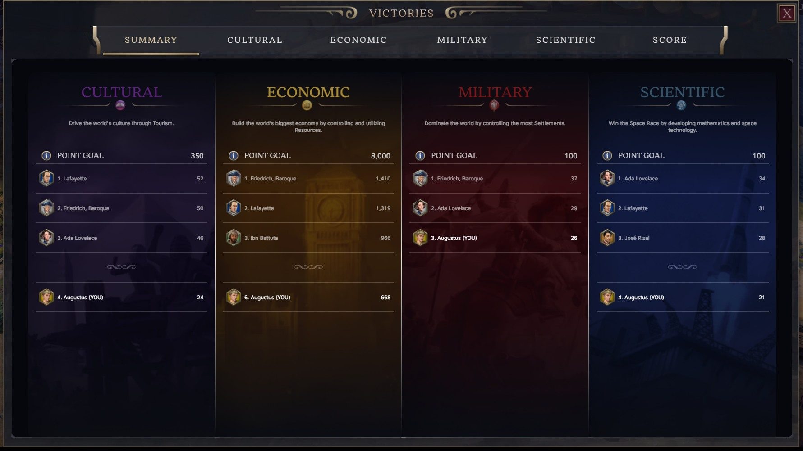

  

  
  
  
  
  
  <!-- Add the Discord badge here once there is an invite link. -->

<h3 align="center">One Civilization. One Timeline. No Forced Age Transitions.</h3>

  What if Civilization VII let you guide your empire through history without ever stopping to begin a new Age? 
  Continuous Civilization turns the three Ages into one unbroken campaign, from the first city to the space race, 
  and every civilization moves into the next Age on its own research.

  <a href="#install">Install</a> ·
  <a href="#how-it-plays">How it plays</a> ·
  <a href="#winning">Winning</a> ·
  <a href="#beta-testers">Beta testers</a> ·
  <a href="#known-limitations">Known limitations</a> ·
  <a href="#faq">FAQ</a>

## Why play it

- 🏛️ **Keep what you build.** The Antiquity Age never ends, so there's no transition, no new civilization and no reset of your empire.
- 🌳 **One tech tree, one civic tree.** Exploration continues straight on from Antiquity and Modern from Exploration, all the way to Future Tech.
- 🧭 **Your own pace.** Each player enters Exploration and Modern through their own research. A leader can be flying planes while a rival still fields knights.
- ⚔️ **Content from every Age.** Units, buildings, governments, religion, resources, diplomacy and espionage from all three Ages, in one game.
- 🏆 **Every main victory works:** Science, Culture, Economic, Military and Domination.

## Install

> **Beta.** Expect rough edges, and start a **new game** after every update: saves from one version may not load in the next.

**Steam Workshop (easiest):** [subscribe here](https://steamcommunity.com/sharedfiles/filedetails/?id=3838777743), then start a new game. Steam keeps it updated.

**Manual install:**
1. Download `continuous-civ.zip` from the newest release on the [Releases page](../../releases).
2. Unzip it into your Civilization VII mods folder, so you get
   `%LOCALAPPDATA%\Firaxis Games\Sid Meier's Civilization VII\Mods\continuous-civ\`.
3. In game, enable **Continuous Civilization** under **Additional Content**. Game updates switch all mods off, so check it again after every Civilization VII update.
4. Start a **new** game with an **Antiquity** start.

Requires Civilization VII (tested on 1.5.1). No game files are included or changed: the mod reads the Exploration and Modern content from your own installed game.

## How it plays

### Personal Ages
| Age | You enter it by researching any of | What changes for you |
|---|---|---|
| Antiquity | (start) | Vanilla Antiquity rules |
| Exploration | Cartography, Astronomy, Machinery | Crossing the Ocean (civilians and commanders after Cartography, all land units after Shipbuilding mastery), deep-ocean ships, embarkation, settlement cap of at least 8, base yields +10 Gold / +20 Science, Culture and Influence, more resource slots and envoys, longer trade routes, stronger embarked units, leader attribute points; the specialist cap rises as in vanilla Exploration, and Age-scaled bonuses (leader abilities, mementos, attribute nodes) double |
| Modern | Academics, Steam Engine, Military Science | Settlement cap of at least 16, base yields +15 Gold / +30 Science, Culture and Influence, Modern resource slots and town focuses, longer trade routes, stronger embarked units, more leader attribute points; Modern specialist cap, and Age-scaled bonuses triple |

### World Age
Costs that vanilla raises in later Ages follow a shared **world Age**, as Civilization VI's world eras do: the world enters Exploration (Modern) once at least half of the living civilizations are in that personal Age. Then everyone's city growth costs (about 1.9x, then 3.3x), town upgrade costs (2x, then 3x) and Influence costs of diplomatic actions (2x, then 3x) rise together, so the first civilization to advance isn't charged more than its rivals.

Techs and civics also cost 20% more when they are from an Age ahead of the world's, and 20% less when from an Age behind it (Civ VI's catch-up), so a leader slows a little and a civilization left behind catches up.

The **Distant Lands** across the Ocean are open from the start: you can meet the civilizations there, and settle their land once your Exploration lets you cross.

### Content from every Age
- **Units and buildings** from all three Ages, unlocked through research, with upgrades across Ages (Galleon to Frigate, Arquebusier to Line Infantry).
- **Governments** unlock by civic. The chooser opens when a new one unlocks, and a **Change Government** button is added to the policies screen. AI civilizations change government too.

  | Exploration | Modern |
  |---|---|
  | Feudal Monarchy | Bureaucratic Monarchy |
  | Plutocracy | Elective Republic |
  | Theocracy | Authoritarianism |

- **Religion** from Exploration: Piety, Temples, founding a religion, beliefs, Missionaries, relics.
- **Resources** from later Ages are on the map from the start, but stay inactive and hidden for each player until they research the matching tech (Coal at Steam Engine, Oil at Combustion).
- **Triumphs** from all three Ages on the Triumphs screen. Exploration and Modern Triumphs count once you reach that personal Age, with vanilla's rewards.
- **Dedications:** Major Triumphs unlock Dedications as in vanilla. Instead of an Age transition, you get 3 Dedication points when you enter your personal Exploration and 3 more in Modern. A **Choose Dedications** window opens at the start of your turn listing the Dedications you've earned, and you pick as many as you have points; anything you skip stays on the new **Dedications** tab of the attribute screen. Antiquity Triumphs' Dedications open from Exploration, Exploration Triumphs' from Modern. AI civilizations receive each Dedication they earn automatically, when they complete its Triumph.
- **Diplomacy and espionage** from later Ages: Demand Tribute and spy actions such as Open the Gates and Sabotage Space Program, each unlocked by its tech, civic or city-state bonus.
- **City-states, great people, projects, narratives and discoveries** from all three Ages share one pool.
- **Ideologies:** Democracy, Fascism and Communism open with Political Theory.

## Winning

| Victory | How to win |
|---|---|
| 🚀 **Science** | 100 Science victory points and an undamaged Launch Pad, then a 5-turn countdown |
| 🎭 **Culture** | 350 Culture victory points, then a 5-turn countdown |
| 💰 **Economic** | 16,000 Economic victory points on Standard speed (8,000 Online, 10,700 Quick, 24,000 Epic, 48,000 Marathon), then a 5-turn countdown |
| ⚔️ **Military** | 100 Military victory points (from the settlements you hold, more for conquered ones and capitals), then a 5-turn countdown |
| 🗡️ **Domination** | Capture every rival's original capital |

In vanilla, Culture, Economic and Military are won by staying 25% ahead of second place, a check the game only runs inside a real Modern Age. Here they use a fixed target, as Science does. Culture and Economic are set so AI leaders reach them late in the game; Military is set above what an empire scores without conquest. All targets will be tuned from beta feedback.

## Beta testers

Thank you for playing! Balance feedback from real games is what this beta needs most.

**Worth noting as you play**
- The turn you enter Exploration and Modern.
- How far you are from the victory targets, and when the game ends (who won, how, which turn).
- Anything that feels too fast, too slow, too strong or too weak.
- Anything broken, missing or odd on screen.

**How to send it:** open an issue here. There are forms for [bug reports](../../issues/new?template=bug_report.yml) and [balance feedback](../../issues/new?template=balance_feedback.yml).

**For crashes and bugs**, attach these logs from `%LOCALAPPDATA%\Firaxis Games\Sid Meier's Civilization VII\Logs\`: `Modding.log`, `Database.log`, `UI.log`.

## Known limitations

- **No turn limit and no Score victory:** a game runs until someone wins (vanilla decides Score when the final Age ends, which never happens here).
- **Triumphs (legacy paths):** two Triumphs can't be completed: one needs Treasure Fleets and the Modern one that grants John Maynard Keynes needs Factory resources, both not yet included. Launch Rocket requires the three earlier space projects instead of the Science legacy path.
- **Later-Age resources can be spotted on the map early.** They do nothing until you research them, and their icons are hidden, but the engine still draws their 3D models and builds their own improvement on the tile, for example an Oil Rig on Oil in Antiquity. The improvement starts working once you have the tech. (During an AI autoplay a few of their icons can also appear.)
- **City art stays Antiquity-style.** Town houses, roads and bridges keep their Antiquity look, because the engine draws them from a single game-wide Age. Buildings, wonders and units from later Ages use their own art. [Details](docs/visual-progression-investigation.md).
- **Ruins** stay Antiquity discoveries all game, so Modern archaeology can't use them.
- **A few numbers stay at Antiquity's values**, because the engine reads them from the one game Age with no per-player version: the Happiness needed for celebrations and for Joyous/Ecstatic settlements, and war weariness. (Growth costs, the specialist cap, town upgrade costs, narrative rewards, and leader, memento and attribute-tree bonuses now follow your personal Age.)
- **Later-Age civilizations' unique Settler, Merchant, Scout and Army Commander replacements are available from the start** (Norman Sokeman, Mughal Zamindar, Mongolian Noyan, Bugandan Mwami, Inca Chasqui, Ming Mandarin, Songhai Tajiro, Qing Hangshang): the engine makes a unique unit available as soon as the unit it replaces is, not at its own tech.
- **AI civilizations can buy some buildings in towns before their tech** (towns with a building-purchase ability, such as Augustus's or a Factory Town); the purchase screen blocks it for you.
- **The AI doesn't overbuild.** You can build later-Age buildings over older ones once you're in a later Age, but AI civilizations keep building on new tiles.
- **No crises** happen.
- **Not yet included:** Treasure Fleets and Factory resources, some Exploration and Modern wonders that come with DLC civilization packs (wonder packs and four civilization-pack wonders are included), and DLC story events.
- Full list with details: [Age-gating audit](docs/audit-age-gated-mechanics.md).
- **Single player only** so far. Multiplayer is untested.

## FAQ

**Can I add it to a game I already started?**
No. The mod changes the game's rules when a game is created, so start a new game.

**Does it work with other mods?**
Untested. Mods that change Ages, the tech or civic trees, or victories are likely to conflict.

**Do I need the DLC?**
It's built on the base game's three Ages and shouldn't need any DLC, but so far it has only been tested with DLC installed. DLC civilizations and leaders work as normal.

**Why does my city still look ancient in the Modern Age?**
See [Known limitations](#known-limitations): the engine only draws city filler art from the game's single Age.

**A game update broke the mod.**
Likely: Civ VII patches can change the data the mod builds on. Please open an issue with your logs.

## Roadmap

- Balance pass from beta feedback: pacing, victory targets.
- Multiplayer testing.
- Per-player visual city changes: city art (houses, roads, bridges) that advances for each player as they research, instead of staying Antiquity's all game. Paused: the engine picks this art from one global Age ([the investigation](docs/visual-progression-investigation.md)); a prototype got part of the way.

## Contributing

Bug reports and balance notes are the most useful contributions right now. For how the mod is built, the tools and the in-game tests, see [CONTRIBUTING.md](CONTRIBUTING.md) and [CHANGELOG.md](CHANGELOG.md).

## Disclaimer

Continuous Civilization is an unofficial fan modification, not affiliated with or endorsed by Firaxis Games or 2K. Sid Meier's Civilization VII and its content are the property of their respective owners. This repository contains no game assets: the mod reads the game's own files from your installation when it loads. Screenshots are from the author's own games.
