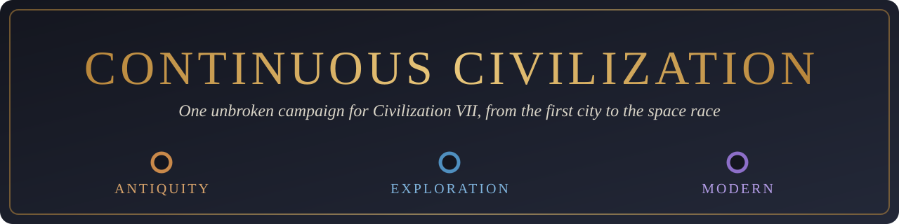
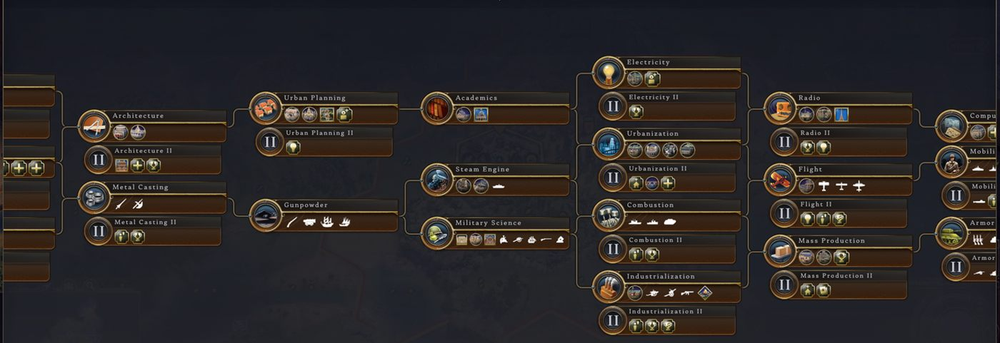
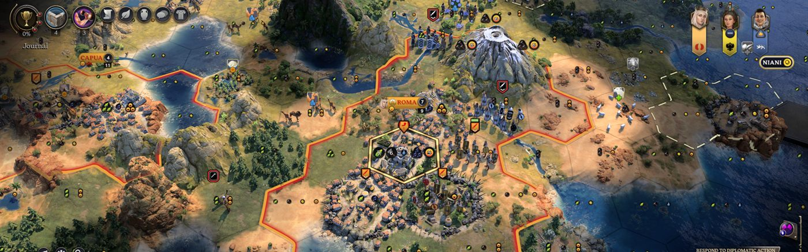
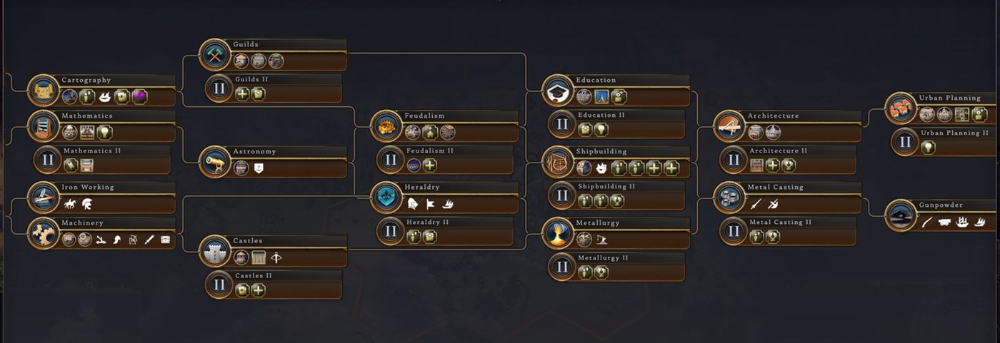

  

  
  
  
  
  
  <!-- Add the Discord badge here once there is an invite link. -->

<h3 align="center">One Civilization. One Timeline. No Forced Age Transitions.</h3>

  What if Civilization VII let you guide your empire through history without ever stopping to begin a new Age? 
  Continuous Civilization turns the three Ages into one unbroken campaign, from the first city to the space race, 
  and every civilization moves into the next Age on its own research.

  <a href="#install">Install</a> ·
  <a href="#how-it-plays">How it plays</a> ·
  <a href="#winning">Winning</a> ·
  <a href="#beta-testers">Beta testers</a> ·
  <a href="#known-limitations">Known limitations</a> ·
  <a href="#faq">FAQ</a>

## Why play it

- 🏛️ **Keep what you build.** The Antiquity Age never ends, so there's no transition, no new civilization and no reset of your empire.
- 🌳 **One tech tree, one civic tree.** Exploration continues straight on from Antiquity and Modern from Exploration, all the way to Future Tech.
- 🧭 **Your own pace.** Each player enters Exploration and Modern through their own research. A leader can be flying planes while a rival still fields knights.
- ⚔️ **Content from every Age.** Units, buildings, governments, religion, resources, diplomacy and espionage from all three Ages, in one game.
- 🏆 **Every main victory works:** Science, Culture, Economic and Domination.

## Install

> **Beta.** Expect rough edges, and start a **new game** after every update: saves from one version may not load in the next.

**Steam Workshop (easiest):** [subscribe here](https://steamcommunity.com/sharedfiles/filedetails/?id=3838777743), then start a new game. Steam keeps it updated.

**Manual install:**
1. Download `continuous-civ.zip` from the newest release on the [Releases page](../../releases).
2. Unzip it into your Civilization VII mods folder, so you get
   `%LOCALAPPDATA%\Firaxis Games\Sid Meier's Civilization VII\Mods\continuous-civ\`.
3. In game, enable **Continuous Civilization** under **Additional Content**.
4. Start a **new** game with an **Antiquity** start.

Requires Civilization VII (tested on 1.5.1). No game files are included or changed: the mod reads the Exploration and Modern content from your own installed game.

## How it plays

### Personal Ages
| Age | You enter it by researching any of | What changes for you |
|---|---|---|
| Antiquity | (start) | Vanilla Antiquity rules |
| Exploration | Cartography, Astronomy, Machinery | Deep-ocean travel, embarkation, settlement cap of at least 8, base yields +10 Gold / +20 Science, Culture and Influence, more resource slots and envoys |
| Modern | Academics, Steam Engine, Military Science | Settlement cap of at least 16, base yields +15 Gold / +30 Science, Culture and Influence, Modern resource slots and town focuses |

### Content from every Age
- **Units and buildings** from all three Ages, unlocked through research, with upgrades across Ages (Galleon to Frigate, Arquebusier to Line Infantry).
- **Governments** unlock by civic. The chooser opens when a new one unlocks, and a **Change Government** button is added to the policies screen. AI civilizations change government too.

  | Exploration | Modern |
  |---|---|
  | Feudal Monarchy | Bureaucratic Monarchy |
  | Plutocracy | Elective Republic |
  | Theocracy | Authoritarianism |

- **Religion** from Exploration: Piety, Temples, founding a religion, beliefs, Missionaries, relics.
- **Resources** from later Ages are on the map from the start, but stay inactive and hidden for each player until they research the matching tech (Coal at Steam Engine, Oil at Combustion).
- **Diplomacy and espionage** from later Ages: Demand Tribute, Treasure Fleets, and spy actions such as Open the Gates and Sabotage Space Program, each unlocked by its tech, civic or city-state bonus.
- **City-states, great people, projects, narratives and discoveries** from all three Ages share one pool.
- **Ideologies:** Democracy, Fascism and Communism open with Political Theory.

## Winning

| Victory | How to win |
|---|---|
| 🚀 **Science** | 100 Science victory points and an undamaged Launch Pad, then a 5-turn countdown |
| 🎭 **Culture** | 150 Culture victory points, then a 5-turn countdown |
| 💰 **Economic** | 12,000 Economic victory points, then a 5-turn countdown |
| 🗡️ **Domination** | Capture every rival's original capital |

In vanilla, Culture and Economic are won by staying 25% ahead of second place, a check the game only runs inside a real Modern Age. Here they use a fixed target, as Science does. The targets are set so AI leaders reach them late in the game, and will be tuned from beta feedback.

## Beta testers

Thank you for playing! Balance feedback from real games is what this beta needs most.

**Worth noting as you play**
- The turn you enter Exploration and Modern.
- How far you are from the victory targets, and when the game ends (who won, how, which turn).
- Anything that feels too fast, too slow, too strong or too weak.
- Anything broken, missing or odd on screen.

**How to send it:** open an issue here. There are forms for [bug reports](../../issues/new?template=bug_report.yml) and [balance feedback](../../issues/new?template=balance_feedback.yml).

**For crashes and bugs**, attach these logs from `%LOCALAPPDATA%\Firaxis Games\Sid Meier's Civilization VII\Logs\`: `Modding.log`, `Database.log`, `UI.log`.

## Known limitations

- **Military (points) victory** can't be won: it uses the 25%-lead check that only runs in a real Modern Age. Use Domination for a military win.
- **Score victory** is decided when the final Age ends, which never happens here.
- **Legacy paths** don't progress, so their Modern rewards (World's Fair, Manhattan Project, John Maynard Keynes) are unavailable. Launch Rocket instead requires the three earlier space projects.
- **Diplomacy costs don't scale by Age.** Shared actions keep Antiquity's Influence costs, which vanilla doubles in Exploration and triples in Modern.
- **City art stays Antiquity-style.** Town houses, roads and bridges keep their Antiquity look, because the engine draws them from a single game-wide Age. Buildings, wonders and units from later Ages use their own art. [Details](docs/visual-progression-investigation.md).
- **Ruins** stay Antiquity discoveries all game, so Modern archaeology can't use them.
- **Single player only** so far. Multiplayer is untested.

## FAQ

**Can I add it to a game I already started?**
No. The mod changes the game's rules when a game is created, so start a new game.

**Does it work with other mods?**
Untested. Mods that change Ages, the tech or civic trees, or victories are likely to conflict.

**Do I need the DLC?**
It's built on the base game's three Ages and shouldn't need any DLC, but so far it has only been tested with DLC installed. DLC civilizations and leaders work as normal.

**Why does my city still look ancient in the Modern Age?**
See [Known limitations](#known-limitations): the engine only draws city filler art from the game's single Age.

**A game update broke the mod.**
Likely: Civ VII patches can change the data the mod builds on. Please open an issue with your logs.

## Roadmap

- Balance pass from beta feedback: pacing, diplomacy costs, victory targets.
- Military points victory.
- Steam Workshop release.
- Multiplayer testing.

## Contributing

Bug reports and balance notes are the most useful contributions right now. For how the mod is built, the tools and the in-game tests, see [CONTRIBUTING.md](CONTRIBUTING.md) and [CHANGELOG.md](CHANGELOG.md).

## Disclaimer

Continuous Civilization is an unofficial fan modification, not affiliated with or endorsed by Firaxis Games or 2K. Sid Meier's Civilization VII and its content are the property of their respective owners. This repository contains no game assets: the mod reads the game's own files from your installation when it loads. Screenshots are from the author's own games.
